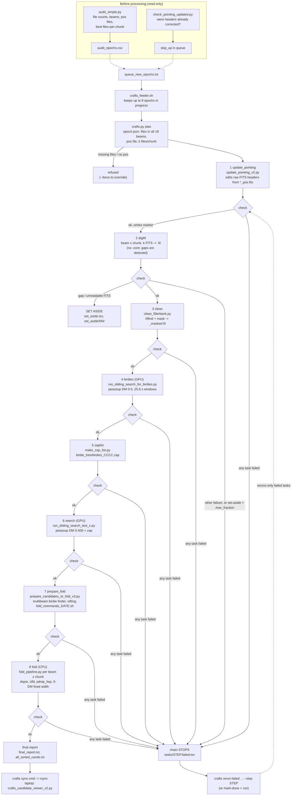

# CRAFTS reprocessing pipeline

An automated reprocessing pipeline for the FAST CRAFTS drift-scan survey: 2-bit PSRFITS, 19 beams,
running on OzSTAR. Each epoch runs as its own chain of SLURM jobs, and a check job between steps
verifies every task before the next step is submitted. The science scripts in `scripts/` are run
unchanged; `automation/` only wraps them.

---

## 1. Full flowchart



The same flow in plain text, for a terminal:

```
 audit_simple.py ─► audit_epochs.csv          check_pointing_updated.py ─► skip_up
            └──────────────► queue_new_epochs.txt ◄──────────────┘
                                   │
                        crafts_feeder.sh  (≤ 8 epochs in progress)
                                   │
                          crafts.py plan ──► refused (missing files / no pos)
                                   │
 ┌─────────────────┐  ┌──────────────────┐  ┌─────────────────┐  ┌─────────────────┐
 │1 update_pointing│─►│2 digifil         │─►│3 clean          │─►│4 birdies   (GPU)│
 │ raw FITS headers│  │ beam×chunk, -f 4 │  │ rfifind + mask  │  │ peasoup DM 0–5  │
 └─────────────────┘  │ gaps → SET ASIDE │  └─────────────────┘  └────────┬────────┘
                      └──────────────────┘                                │
 ┌─────────────────┐  ┌──────────────────┐  ┌─────────────────┐  ┌────────▼────────┐
 │8 fold      (CPU)│◄─│7 prepare_fold    │◄─│6 search    (GPU)│◄─│5 zaplist        │
 │ dspsr/clfd/pdmp │  │ multibeam birdies│  │ peasoup DM 5–500│  │ .zap per chunk  │
 │ 0-DM fixed width│  │ sift → commands  │  │ + zap           │  └─────────────────┘
 └────────┬────────┘  └──────────────────┘  └─────────────────┘
          ▼
   final report ─► crafts sync-cmd (rsync) ─► laptop: candidate viewer

 After EVERY box a check job runs:
   SLURM state + per-task END marker + expected outputs + error patterns in the logs
     all ok   → state/STEP.json = complete → submits the next box
     any fail → chain stops, tasks/STEP.failed.tsv → crafts rerun-failed → continues
```

---

## 2. What each step does

All paths are under the epoch folder `crafts_processing/<project>/<pointing>/<date>/`.
`NN` = beam 01–19, `CCCC` = chunk number.

| # | step | runs | input → output | passes when |
|---|---|---|---|---|
| plan | `crafts.py plan` | login node | raw file names → `pipeline/epoch.json` | 19 beams, no missing file numbers, one pos file |
| 1 | **update_pointing**: `update_pointing_v2.py` | 1 CPU job | raw FITS + `*_pos.fits` → headers edited in place (raw files set to read-only afterwards) | an `Updated` line for every FITS file, no `ERROR`, no `skipping` → writes `state/update_pointing.done` |
| 2 | **digifil** `-f 4` | array, beam × chunk | k raw FITS → `NN/<prefix>-MNN_CCCC.fil` | `.fil` exists; a time gap or unreadable FITS → **set aside** |
| 3 | **clean**: `clean_filterbank.py` | array | `.fil` → `NN/…_masked.fil`, `rfi_masks/…_peasoup.kill` | both files exist |
| 4 | **birdies**: `run_sliding_search_for_birdies.py` | GPU array | `_masked.fil` → `NN/…_masked_birdies/candidates_with_beam.csv` | exit 0, no peasoup/CUDA error in the log (no candidates is fine) |
| 5 | **zaplist**: `make_zap_list.py` | 1 CPU job | 19 beams' birdie CSVs per chunk → `birdie_lists/birdies_CCCC.zap` | one `.zap` per chunk (an empty one is created, with a warning, if a chunk has none) |
| 6 | **search**: `run_sliding_search_test_z.py` | GPU array | `_masked.fil` + chunk's `.zap` → `NN/…_masked_candidates/candidates_with_beam.csv` | as step 4 |
| 7 | **prepare_fold**: `prepare_candidates_to_fold_v3.py --dec_deg <from pointing>` | 1 CPU job | all candidate CSVs → `sifting_output/`: `raw_candidates_CCCC.txt`, `birdies_CCCC.csv/.zap`, `sifted_candidates_CCCC.txt`, `fold_inputs/candidates_beam_NN_chunkCCCC.csv`, `fold_commands_<date>.sh` | commands file written (an old one is first moved to `.bak_<job>`) |
| 8 | **fold**: `fold_pipeline.py` | CPU array, one line of the commands file per task, 3 CPUs | → `fold_inputs/fold_results/<stem>/beamNN/chunkCCCC/sorted.cands` + PNGs | `sorted.cands` exists |
| – | **report** | written by the last check | → `pipeline/final_report.txt/.json`, `sifting_output/all_sorted_cands.txt`, `all_sifted_candidates.txt` | — |

### Inside step 7 (sifting)
1. Load every beam's search candidates for each chunk. Chunks are found from beam 01's folder;
   a set-aside M01 gets an empty placeholder folder so the chunk isn't missed.
2. **Multibeam birdie finder**, using candidates with S/N > 10 at DM 0–500, Chen+2025 beam geometry,
   and the drift rate at the pointing's declination. A frequency is flagged as RFI if **any** of these
   is true:
   - (a) it persists in more windows in one beam than a drifting point source could;
   - (b) it's present in all 19 beams in one window;
   - (c) it's detected in beams farther apart than a point source allows.
3. Period / harmonic / S/N filters c1–c8, then removal of the flagged birdie frequencies.
4. Write the per-beam fold inputs and one fold command per beam × chunk.

### Inside step 8 (fold, per beam × chunk)
1. Filter candidates with c1–c8, and query ATNF for known pulsars near the beam.
2. Fold with dspsr: `-L 1` normally, single-pulse mode `-s -K` for P > 1 s. One fold per
   window, using the window's `start_sec` and `T_window`.
3. Clean with clfd: std/ptp/lfamp, despike, 3 processes.
4. First pdmp pass with `pdmp_fwp -mc 32 -ms 24 -mb 128`, searching period and DM.
5. Keep folded S/N ≥ 7 and DM > 2, then refold survivors with the corrected P/DM.
6. 0-DM copy (`pam -d 0`), clfd, then `pdmp_fwp -fw <width in bins from the DM pass>`.
7. EPS → PNG, then build `sorted.cands`: FFT values, pdmp values, 0-DM S/N ratio, duty cycle,
   and PNG and filterbank paths.

---

## 3. How the automation works

- **The plan.** Chunks of `k` files are cut from the start of each epoch. `k` is an exact divisor
  of the file count with chunks of 120–480 s, chosen closest to 245 s. Leftover files at the end are
  skipped and recorded as `remainder_files_per_beam`.
  - 1444 files/beam: k=19, 76 chunks
  - 1398 files/beam: k=15, 93 chunks, 3 left over
  - 1118 files/beam: k=13, 86 chunks
- **Task lists.** Each step has `pipeline/tasks/<step>.tsv`, one line per task. Array element *i*
  runs lines `offset + i·pack … + pack − 1`.
- **Packing.** One array element runs `pack` task lines one after another. Every line writes
  `CRAFTS_TASK_START` / `CRAFTS_TASK_END … exit=N` to both `.out` and `.err`, so the check, set-aside
  and reruns all work **per line**. The job time requested is `pack × task_time × 1.25 + 5 min`.
- **GPU partitions.** This cluster drops the second name from `--partition=a,b`. So with
  `partitions = milan-gpu,skylake-gpu`, the task list is split into **one array per partition**,
  shared out by `partition_weights`.
- **Fold classes.** Fold tasks are grouped by candidate count, and each group gets its own time limit.
- **Check job.** It runs `afterany` the step's jobs. For each task it looks at:
  1. the SLURM state;
  2. the `END` marker's exit code;
  3. the expected outputs;
  4. the `[fail_patterns]` in that task's own log section.

  If everything passes, it submits the next step. If anything fails, it writes
  `tasks/<step>.failed.tsv` and stops the chain.
- **Set aside** (digifil only). A gap (`is not contiguous`) or an unreadable FITS (`FITSIO status`)
  isn't counted as a failure:
  - the beam × chunk goes into `pipeline/set_aside.tsv`;
  - its partial outputs move to `set_aside/NN/`;
  - later steps skip it.

  If the share of set-aside tasks is above `[set_aside] max_fraction`, the chain stops instead.
- **Config changes reach running epochs.** `epoch.env` is rewritten before every submission.
- **Job names** start with the epoch, e.g. `Dec+3219_0328_digifil` or `Dec-0536_1027_search_skylake-gpu`.

### Measured on Dec+3135_01_05 (1444 files/beam), and the settings used

| step | per task (median / p95) | peak mem | settings |
|---|---|---|---|
| update_pointing | 49.5 min | 340 MB | `time 01:30:00`, `mem 1G` |
| digifil | 3.7 / 4.0 min | 190 MB | `pack 4`, `task_time 00:05:00` |
| clean | 2.1 / 2.5 min | 330 MB | `pack 4`, `task_time 00:03:00`, `mem 1G` |
| birdies | 18 / 50 s | 180 MB | `pack 38`, `task_time 00:00:40`, 2 GPU partitions |
| search | 66 / 71 s | 600 MB | `pack 19`, `task_time 00:01:30`, 2 GPU partitions |
| prepare_fold | 20 min | 680 MB | `time 01:00:00`, `mem 2G` |
| fold | ~6–9 s per candidate (long tail) | — | classes: ≤50 → 45 min, ≤150 → 3 h, ≤300 → 4 h, more → 8 h; 3 CPUs |

---

## 4. Folder layout

```
crafts_pipeline/
  automation/   crafts.py, crafts_config.ini, crafts_feeder.sh, queue_new_epochs.txt, steps/*.sbatch
  scripts/      update_pointing_v2.py, clean_filterbank.py, run_sliding_search_for_birdies.py,
                peasoup_runner.py, make_zap_list.py, run_sliding_search_test_z.py,
                peasoup_runner_test_z.py, prepare_candidates_to_fold_v3.py, fold_pipeline.py
  audit/        audit_simple.py, audit_raw.py, audit_processed.py, check_pointing_updated.py
  viewer/       crafts_candidate_viewer_v2.py (laptop)

<proc_root>/<project>/<pointing>/<date>/
  01 … 19/                .fil, _masked.fil, _masked_birdies/, _masked_candidates/
  rfi_masks/  birdie_lists/  set_aside/
  sifting_output/         candidate lists, birdie tables, fold_inputs/, fold_commands_<date>.sh, all_*.txt
  pipeline/
    epoch.json  epoch.env  pipeline.log  set_aside.tsv  final_report.txt/.json
    state/<step>.json  state/update_pointing.done
    tasks/<step>.tsv  tasks/<step>.failed.tsv  tasks/<step>.rerunN.tsv
    logs/<step>/…out/.err  logs/check_<step>_<job>.out
<proc_root>/automation_logs/   events.log, resources.csv (every task's run time and memory)
```

---

## 5. Commands

```bash
alias crafts="python3 /aphid/temp/fast_crafts/crafts_processing/crafts_pipeline/automation/crafts.py \
              -c /aphid/temp/fast_crafts/crafts_processing/crafts_pipeline/automation/crafts_config.ini"

# start / feed
./crafts_feeder.sh queue_new_epochs.txt 8 900 | tee -a feeder.log   # inside tmux
crafts run <pointing> [--date D] [--from STEP | --only STEP] [--dry-run]
crafts plan <pointing> [--date D] [--k N] [--force]

# watch (read-only)
crafts status
crafts show <pointing> --date D          # failed tasks with reasons, last log lines
crafts set-aside [<pointing>] [--out f.csv]
crafts timing <pointing>                 # queue wait vs run time per step
crafts resources                         # run time / memory per step -> suggested requests

# fix
crafts rerun-failed <pointing> --date D --step STEP [--time HH:MM:SS] [--mem 2G]
crafts mark-done   <pointing> --date D --step STEP --reason "..."   # then: crafts run <pointing> --date D
crafts cancel      <pointing> [--date D]

# results
crafts report   <pointing> --date D
crafts sync-cmd <pointing> [--dest ~/crafts]   # rsync command for the laptop
```

### Common situations

| you see | meaning | do |
|---|---|---|
| `UP XX` | update-pointing log has ERROR or skipping lines (usually unreadable raw files) | look at `pipeline/logs/update_pointing/*.log`; if it's only unreadable files, `mark-done … --step update_pointing`, then `run` |
| `DF XX` "too many set aside" | more than `max_fraction` of chunks have gaps or unreadable FITS | `crafts set-aside <pointing>`; if they're genuine, `mark-done … --step digifil`, then `run` |
| `XX` "N failed" | tasks timed out, ran out of memory or errored | `crafts show`; `rerun-failed`, with `--time` or `--mem` if needed |
| `!!` stalled | the step's jobs are gone and no check ran | `crafts run <pointing> --date D` |
| feeder not starting new epochs | 8 epochs in progress, and **failed epochs count** | fix the `XX` epochs |

---

## 6. Known issues in the science scripts (not changed by the automation)

- `fold_pipeline.py`: pdmp runs twice in the first pass (`pool.map` followed by a `for` loop).
- `fold_pipeline.py`: the 0-DM `pdmp_fwp -fw` call has no `-mc 32`, unlike the DM pass.
- `fold_pipeline.py`: the final `rm -f … *.txt` deletes `*_nearby_pulsars.txt`, unless the cleanup
  line has been changed to keep it.
- `fold_pipeline.py`: the ATNF catalogue is downloaded in every fold task.
- `prepare_candidates_to_fold_v3.py`: writes `fold_pipeline_v3.py` into the commands, which the fold
  wrapper replaces with `fold_script`. It also appends to the commands file, which is why the
  automation moves an old file aside first.
- `make_zap_list.py` and `prepare_candidates_to_fold_v3.py`: both find chunks from beam 01 only.
